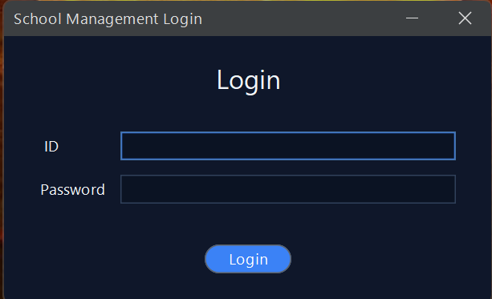
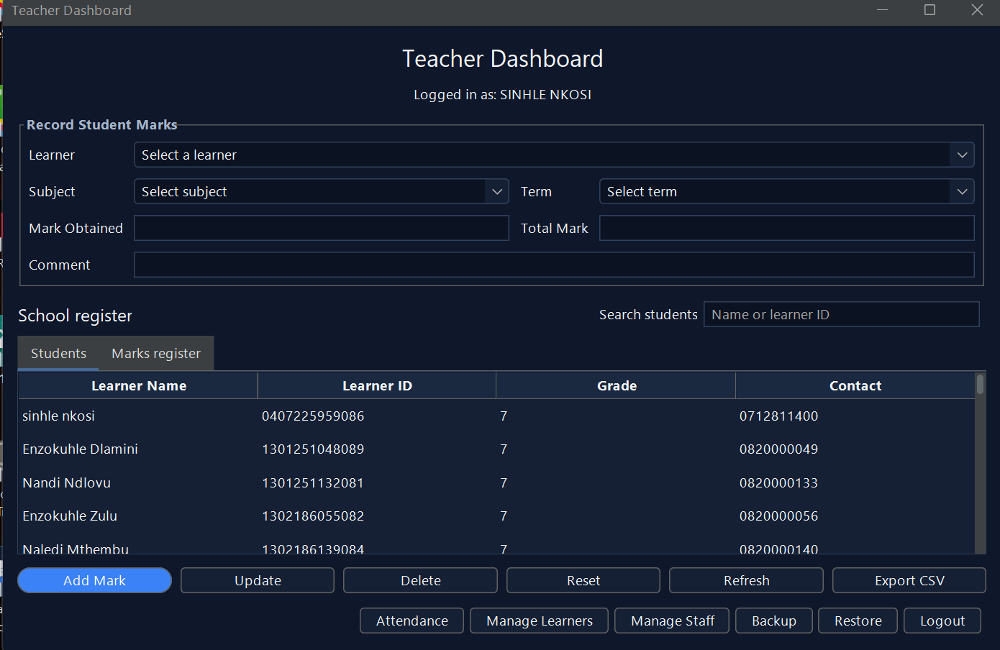
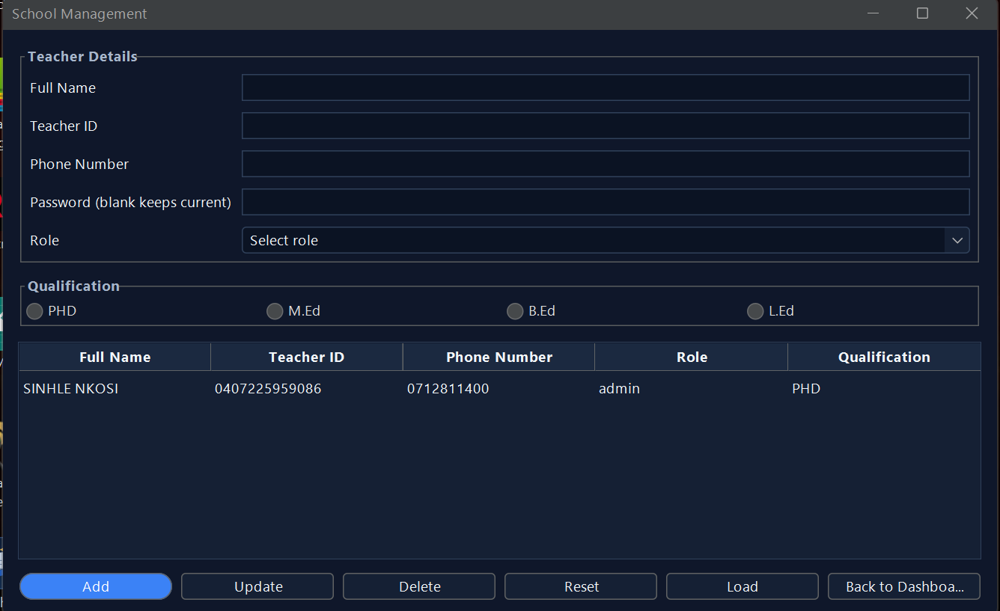
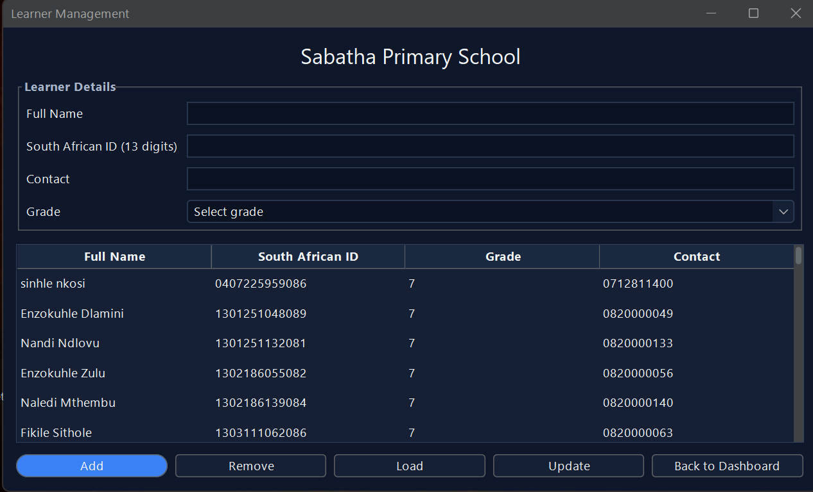
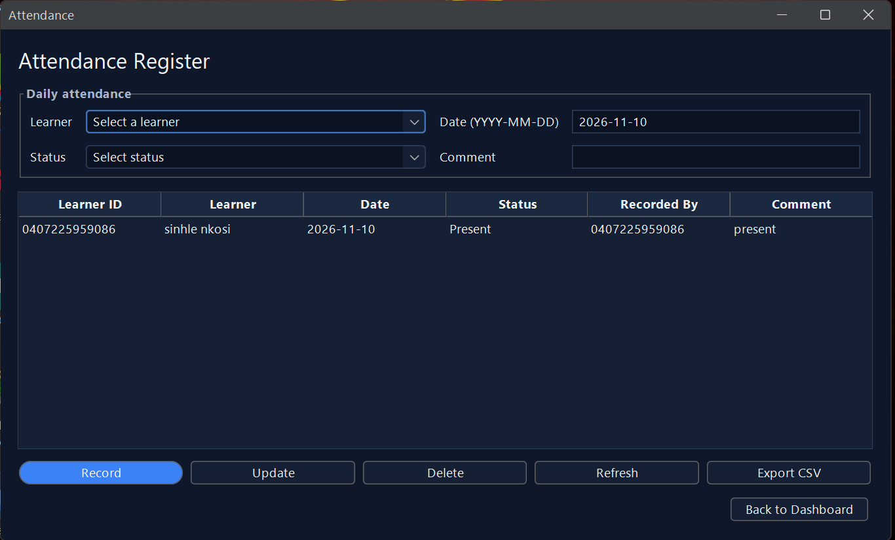
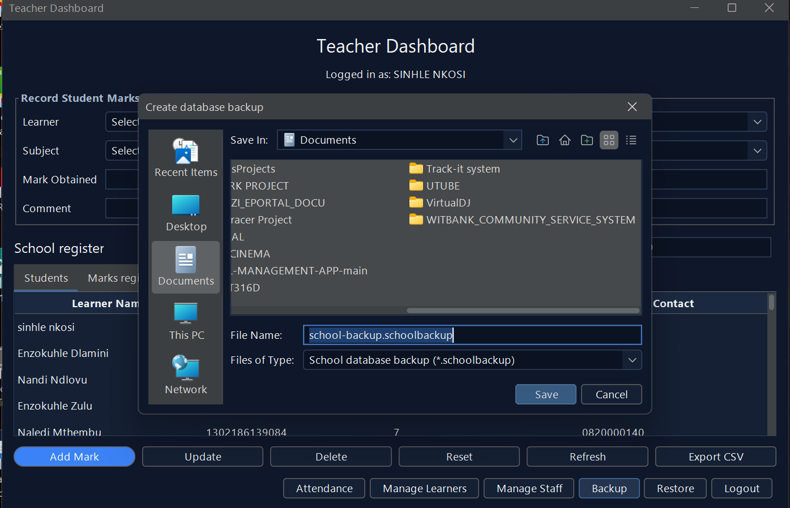
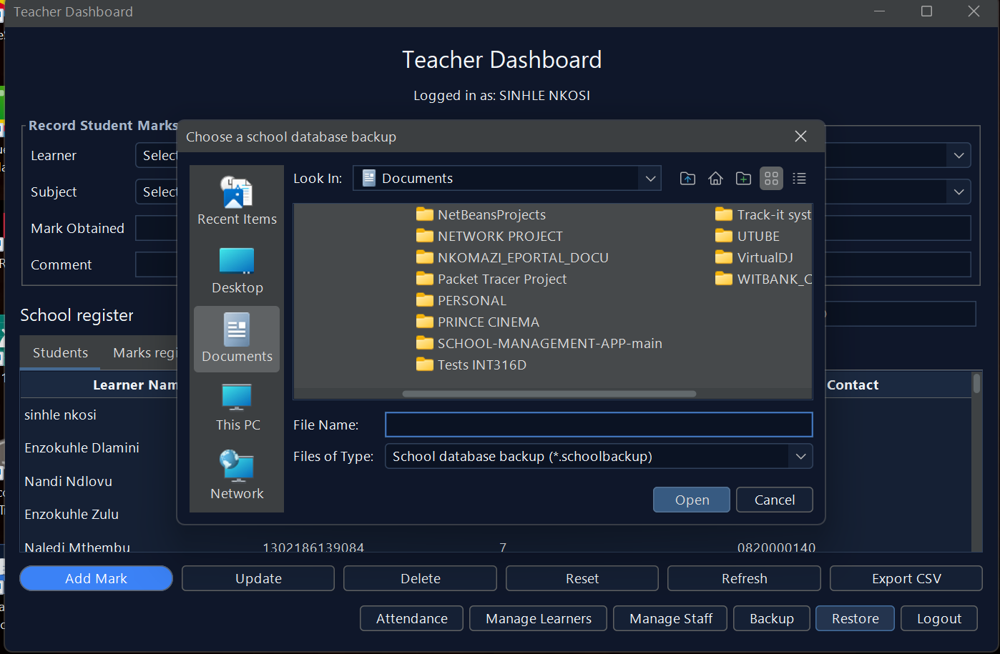

# School Management System

A Java Swing desktop application designed to manage school records, including teacher information, learner information, authentication, and student marks management.

The system uses JDBC with MySQL Server. MySQL Workbench is used to configure and inspect the database.

---

## Features

### Login System

- User authentication
- Secure login validation
- Session management

### Teacher Management

- Register new teachers
- View teacher records
- Update teacher information
- Delete teacher records
- Assign teacher roles
- Select teacher qualifications

### Teacher Dashboard

- Central navigation interface
- Quick access to management modules
- Improved user experience

### Learner Management

- Register learners
- View learner records
- Update learner information
- Delete learner records
- Manage learner details

### Student Marks Management

- Record marks for a learner selected from the register
- View marks records
- Update marks
- Delete marks
- Search and export marks to CSV

### Attendance and Reports

- Record daily present, absent, or late status
- Prevent duplicate attendance entries for the same learner and date
- Export attendance records to CSV

### Backups

- Create a full database backup
- Restore a backup using a transaction
- Restrict backup and restore actions to administrators

### Database Management

- JDBC database connection
- MySQL Server and MySQL Connector/J
- CRUD operations
- Learner foreign-key relationships and attendance records
- Background database tasks to keep the interface responsive
- Windows app-image packaging with `jpackage`

---

## Technologies Used

- Java
- Java Swing
- JDBC
- MySQL Server
- MySQL Connector/J
- Maven

---

## Project Structure
School-Management-System
├── src
│   └── schoolmanagement
│       └── za
│           ├── GUI Classes
│           ├── Database Classes
│           ├── Management Classes
│           └── Model Classes
│
├── screenshots
│
├── README.md
└── build.xml

---

## Screenshots

### Login



### Administrator Dashboard



### Teacher Dashboard



### Learner Dashboard



### Attendance



### Backing Up Data



### Restoring Data



---

## How To Run

1. Clone the repository:
git clone https://github.com/PrinceSinhle/SCHOOL-MANAGEMENT-APP.git

2. Install and start MySQL Server 8.0 or later. Workbench is the management client; it does not replace the server.
3. In Workbench, open `database/mysql-setup.sql`, replace the sample account password, and run it using an administrator connection.
4. Optional: in Workbench, run `database/seed-demo-learners.sql` to add 200 fictional learners with synthetic 13-digit IDs and fake contact numbers across Grades 1–7. These values are for demonstration only and are not verified against Home Affairs.
5. Set the Windows user environment variable `SCHOOL_DB_PASSWORD` to that same password, then fully restart VS Code. The defaults are `127.0.0.1:3306`, database `school_management`, and user `school_app`. `SCHOOL_DB_URL` and `SCHOOL_DB_USER` can override them.
6. Open the repository root in VS Code. Install **Extension Pack for Java** and **Maven for Java**, then let Maven import the project and download Connector/J.
7. Open `src/schoolmanagement/za/App.java` and select **Run** above `main`.

The learner register accepts 13-digit South African ID numbers with valid dates and checksums. The database primary key prevents the same ID from being stored twice. Format and checksum validation does not verify that Home Affairs issued an ID.

To build a Windows app-image with a bundled Java runtime, run `package-windows.ps1` from PowerShell. Packaging requires Maven 3.6.3 or later and JDK 21. MySQL Server must still be installed and running on the target computer; the app-image bundles the Java runtime and JDBC driver, not the database server.

The old Derby database is not copied automatically. Export and import its records if you need to retain them.

On first launch without an administrator, use **Set Up First Administrator**. After that, only admins can manage staff. Teachers can manage their own marks and attendance records; principals and admins can manage learners and view all marks and attendance. Old plain-text staff passwords are upgraded to salted PBKDF2 hashes after successful sign-in.

When upgrading an existing MySQL database, the app adds a learner foreign key if every existing mark points to a registered learner. To locate unmatched records, run this in Workbench and correct them before adding the constraint:

```sql
SELECT m.mark_id, m.learner_id, m.learner_name
FROM StudentMark m
LEFT JOIN Leaner l ON l.id = m.learner_id
WHERE l.id IS NULL;
```

Backups contain learner and staff information, including password hashes. Store them securely. Restoring replaces current records; the app asks for confirmation first.

---

## Database Setup Script

`database/mysql-setup.sql` creates the database, app account, and initial tables. Use a strong password in place of the sample value. Do not commit a real password to the repository.

---

## Author

PrinceSinhle

GitHub:
https://github.com/PrinceSinhle
